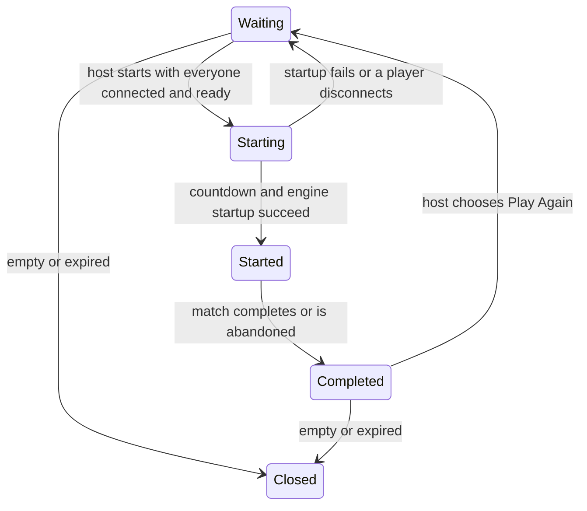

# Party matches, results, and rematches

F027 completes the private lobby-to-match flow using the shared GameEngine. A ready host starts a server-timed countdown, all members transition to the game screen, and ended matches return to results in the same lobby. The minimal game screen supports category selection, bidding, bluff calls, timed word submissions, round scores, and final standings. F028 adds [Party reconnection and intentional match departure](party-reconnection.md). Presentation polish remains later work.

## Countdown and one-match startup

`Sessions:LobbyStartCountdown` defaults to three seconds; supported values range from zero to ten seconds. Zero is useful for controlled integration tests. The store reserves startup atomically and publishes one startsAt timestamp. LobbyResponse includes serverTime so the browser estimates the remaining time without trusting its wall clock. Clients only display the countdown; they never decide when gameplay begins.

The shared engine creates and initializes the new session, then waits for the server deadline before starting its first round. Timer wakes are rechecked against that deadline. All members receive the same lobby gameId/startsAt through SSE. HTTP requests remain pending during the countdown, while SSE updates every connected client. Concurrent start requests conflict during reservation; retries after a successful start return the committed game rather than creating another. F026's latest-presence validation and startup compensation still apply.

## Gameplay boundary

`POST /api/v1/games/{gameId}/actions` accepts the existing discriminated GameActionRequest union: selectCategory, placeBid, callBluff, and submitWord. Every command requires an actionId and canonical nonnegative expectedVersion string. The handler derives the actor from the protected cookie, checks membership and the JSON/origin policy, and delegates decisions to GameEngine. It accepts no client-chosen actor, score, validation outcome, turn, or deadline.

Invalid requests return 400, unauthenticated calls 401, unavailable/nonmember games 404, forbidden player actions 403, and stale/duplicate/phase/turn conflicts 409. Accepted writes return GameActionResponse; SSE invalidation and an authoritative state refresh update the UI. Writes are not automatically retried. Duplicate action IDs are rejected by the existing engine replay guard; original-response receipt replay is not introduced.

The frontend automatically transitions from `/lobbies/{lobbyId}` to `/lobbies/{lobbyId}/game`. That screen keeps the lobby stream for membership/lifecycle and uses the existing game state/SSE synchronization service for turns, timers, scores and action results. Feature components delegate networking to API services. Controls reflect the active player and phase; backend guards remain authoritative. Countdown/challenge clocks are display estimates only.

The shared GameplayTimeoutWorker invokes the guarded NextRound operation for both modes three seconds after an intermediate round result, using its round ID and revision. PartyLifecycleWorker checks playing lobbies once per second and copies completed match standings into the lobby's immutable lastResult. An abandoned or missing game instead produces an ended match without invented scores; no separate Party gameplay rules are maintained.

## Results, rematch, and declining

Completed results show final ranks, scores, winner IDs, and shared victories. The lobby retains the latest result independently of completed-session retention, so the result view still works after normal game-session cleanup. There is no persistent match history.

`POST /api/v1/lobbies/{lobbyId}/rematch` takes `{ "expectedVersion": "<current revision>" }`. Only the current host can prepare a rematch after the match ends. It returns the same lobby to waiting, preserves settings and current identities/membership, clears the current game ID/countdown, and resets readiness. Every client returns to the lobby screen. The next valid start creates a new engine session with zero scores, round one, and no previous bids, challenges, submissions, or round results. Starting the new match clears lastResult.

Players who decline use Leave lobby, either from results or the renewed waiting room. Host departure uses F026 migration. Remaining members must explicitly become ready again; fewer than two connected, ready members cannot start. F028 adds an explicit leaveMatch action for active play; lobby removal remains outside that workflow. No membership changes mutate a previously started game's fixed roster or settings.

## Retention and cleanup

Starting reservations and active matches retain their lobby beyond its original waiting deadline. Once the game ends, expiresAt is reset to server time plus `Sessions:LobbyLifetime` (default 30 minutes). A rematch waiting room uses that deadline; ordinary ready/join actions do not renew it. Empty or expired waiting/results lobbies release their codes, creation receipts, and SSE subscriptions through the existing store cleanup.

Existing game-session disconnected grace and completed/abandoned retention continue to govern session cleanup. The lifecycle worker observes ended sessions before their default retention elapses (completed: ten minutes, abandoned: five minutes). Lobby result retention remains in memory and holds only the latest result. Backend restart still loses lobbies, games, and retained results.

## Acceptance review

| F027 criterion | Evidence |
| --- | --- |
| Ready players start a valid match | Existing host/readiness gate, server countdown, shared-engine startup and browser flow. |
| Same start event for every participant | Two authenticated SSE streams verify identical startsAt and gameId; desktop/mobile navigation. |
| No simultaneous duplicate matches | Atomic reservation, concurrent-start rejection, retry returning one game ID. |
| Completed matches display results | Public actions finish real matches; final standings/ties UI and result retention tests. |
| Rematch without creating a lobby | Same lobby ID/code and identities with a new game session; API and browser journeys. |
| Scores/temporary state reset | New engine aggregate; API checks zero scores and absent bid/challenge/result, browser checks zero scores. |
| Membership/settings consistent | Immutable match settings/roster, rematch preservation, explicit readiness reset and decline/leave behavior. |
| Safe abandoned-lobby cleanup | Abandoned game lifecycle test, empty-room removal, existing session cleanup and expiry regression checks. |
| Relevant tests pass | 79 focused backend tests, 36 frontend tests, ten desktop/mobile browser tests; builds, lint, formatting and generated-contract checks. See [testing](testing.md). |

All nine criteria are implemented. The full regression suite remains part of PR CI.
